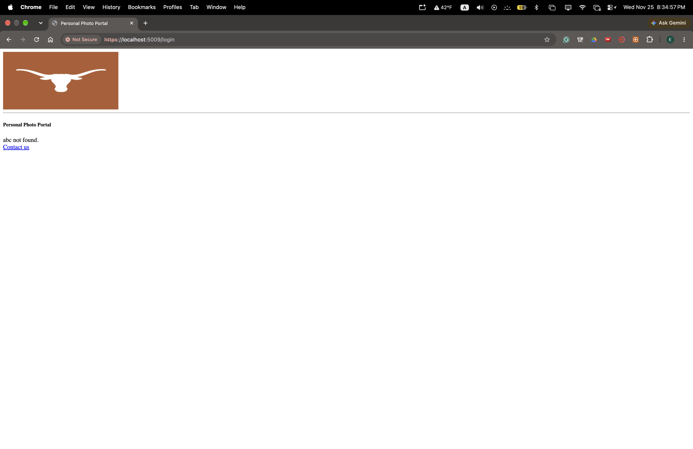
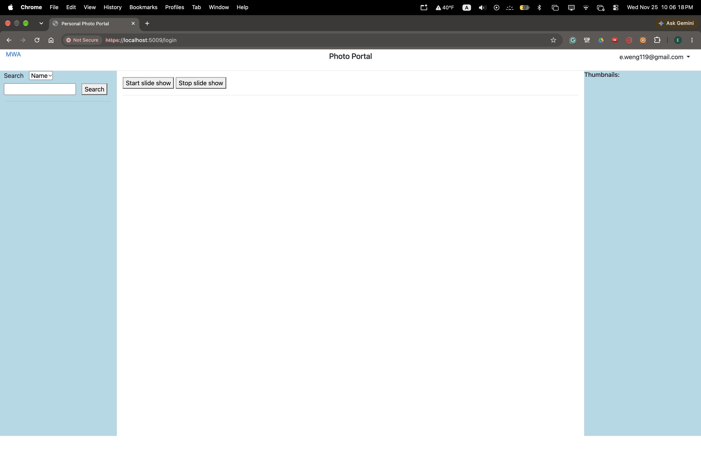

# Assignment 5 Writeup

## Reflection

Deploying the app on EC2 was the most difficult requirement for me, this was requirement 5. This was because after cloning the repo, and then installing all the requirements, the app still wouldnt start. I read the app.log log file and saw an error that said "No module named urllib3.packages.six.moves". Revisiting the walkthrough, I reinstalled urllib3, but the app failed again with a new error but from flask of "pkgutil has no attribute get_loader". After going through the error paths, and going through the walkthrough again, I saw the walkthrough used python3.12-venv, but my instance used 3.14. The old package versions in requirements.txt do not work with the newer python in the EC2. I fixed it by upgrading Flask and requests as well.

## Testing

Before each commit for each requirement, I tested it. I used curl and sqlite3 to check that users were being added, any duplicates were rejected, and passowords were being stored hashed. I did testing by using an unknown user with the admin login, wrong passwords, then the correct ones. I tested google login and checked after that a general user was created in the database. Then using the public URL and after I deployed to EC2, I confirmed the admin and Google logins both work. 

## Screenshots

Requirement 2.4: logging in at /admin with an unknown username shows error message. 

Requirement 3.3: A general user logs in with Google and it appears in the portal.